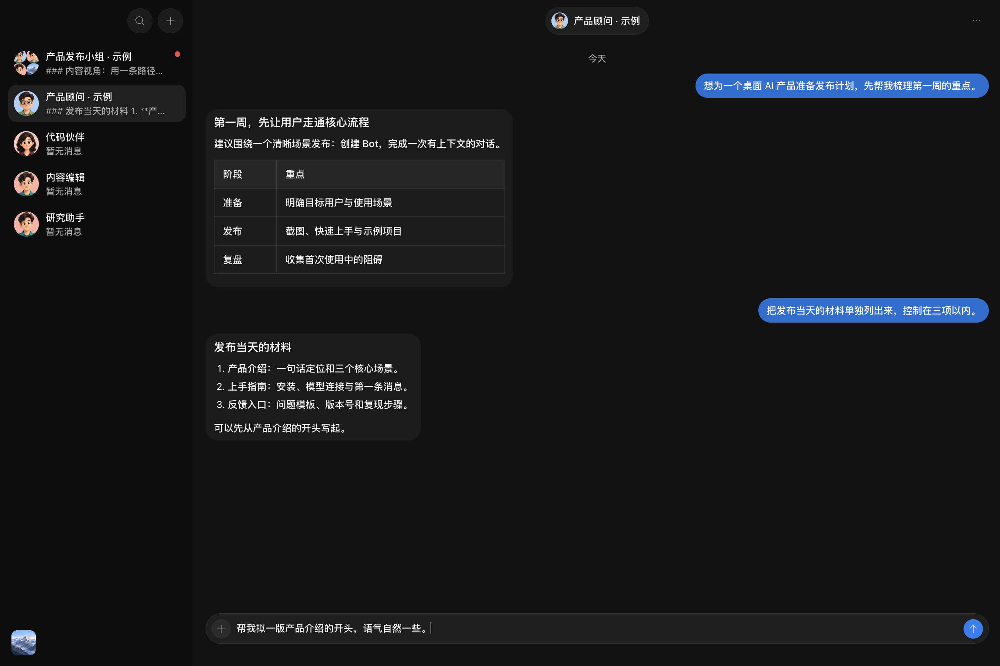
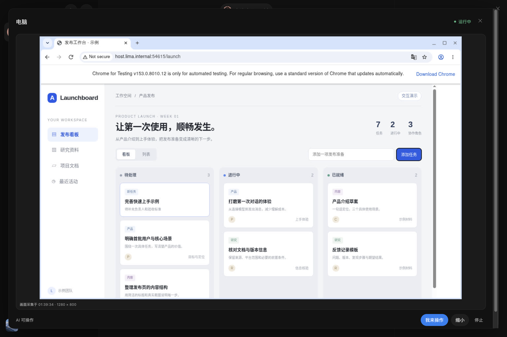
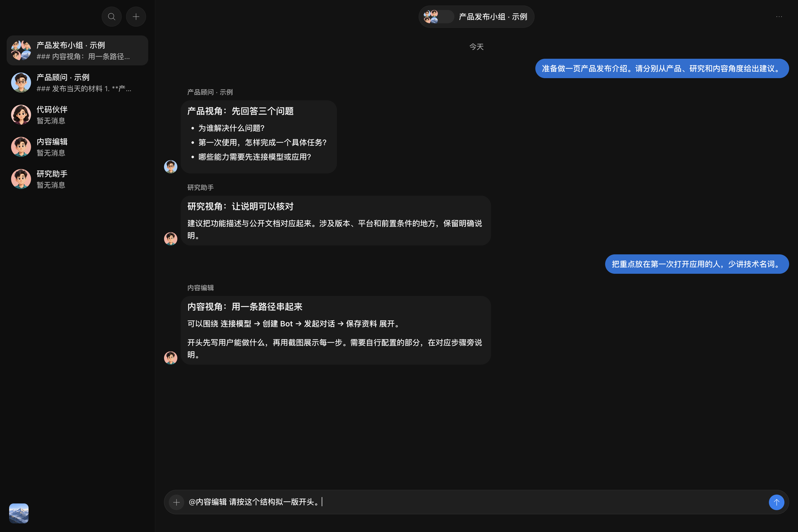
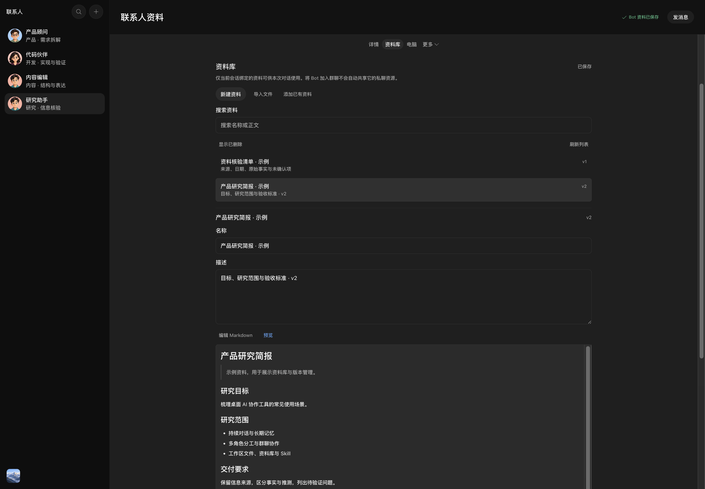
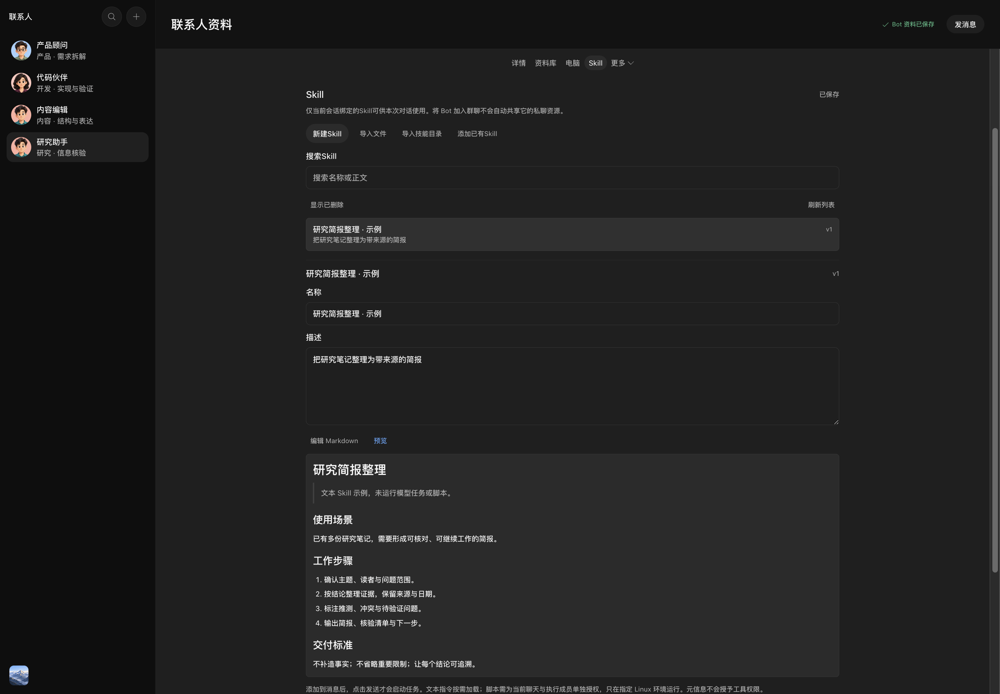

<div align="center">


# Aevoren

**把 AI 变成长期协作的联系人。**

在一个本地桌面工作台中，与 Bot 对话、组建协作群、管理资料和 Skill，让 AI 使用隔离电脑，或你明确选定的 Mac 窗口与浏览器标签页。

简体中文 · [English](README.md)

[](https://github.com/CMSKL/Aevoren/releases/tag/v0.3.0-beta.44) [](https://github.com/CMSKL/Aevoren/actions/workflows/ci.yml?query=branch%3Abeta) [](LICENSE)

[主界面](#主聊天界面) · [电脑能力](#让-ai-直接使用电脑) · [下载安装](#下载安装) · [快速上手](#快速上手) · [产品截图](#产品截图) · [功能详解](#功能详解) · [源码开发](#源码开发) · [项目资源](#项目资源)

</div>

## 主聊天界面



<p align="center"><sub>v0.3.0-beta.42 主聊天界面：会话列表、连续对话与消息输入。图中对话为预置示例。</sub></p>

Aevoren 是一个**本地优先的 Agent 聊天工作台**。每位 Bot 都有自己的角色、模型和长期对话；群聊让多个 Bot 围绕同一项工作协作；资料、记忆、工具权限和执行记录随会话保存。你可以连接 OpenAI-compatible API、Claude Code 或 Codex CLI，并为电脑任务单独选择执行模型。

本地优先意味着聊天记录和应用状态保存在自己的电脑上。调用模型、访问网页或使用外部应用时，相关内容仍会发送给所选服务，详见[数据与权限](#数据与权限)。

## 让 AI 直接使用电脑

给 Bot 一个目标，再选择它工作的地方：**内置 Linux 电脑**可以隔离浏览网页、运行代码和处理文件；在你的 Mac 上，也可以单独授权一个**后台应用窗口或共享浏览器标签页**。你能查看真实画面与结果，随时接手，再明确交还给 AI。



<p align="center"><sub>真实运行的隔离电脑与浏览器，页面为本地演示内容。截图方式与操作记录见下方截图记录。</sub></p>

| 电脑目标 | 可以做什么 | 准备与边界 |
| --- | --- | --- |
| **Bot 的内置电脑** | 浏览器与桌面操作、Shell / Python / Node、Linux 应用和持久文件 | 本机 Docker Linux 引擎；工作目录和登录资料按聊天与执行成员隔离 |
| **这台 Mac 的共享浏览器标签页** | 后台截图、点击、输入、读取与导航，使用该标签页已有登录状态 | 手动载入并配对扩展，明确共享标签页；不复制 Cookie、不切换当前标签页 |
| **这台 Mac 的应用窗口** | 后台操作可访问按钮、文本字段与全选 | 明确选择窗口，授予屏幕录制与辅助功能权限；窗口截图要求 macOS 14+ |

Bot 与群详情统一使用一个**电脑**入口。**设置 → 电脑**管理“你的电脑”和“Bot 的电脑”；**设置 → 模型**选择独立的电脑执行模型。“我来操作”暂停 AI 访问，“交给 AI”明确归还控制权。配置和限制见下方[电脑目标说明](#2-电脑目标浏览器与执行环境)。Linux 截图展示的是由截图流程实际操作的浏览器，没有调用 AI 模型。

## 版本与适用范围

本页介绍 **v0.3.0-beta.44**，发行准备日期为 **2026-10-22**：产品更名为 Aevoren，修正要求识别与真实文件回执，改善 Docker 桌面容量预检、电脑子任务等待、健康状态和安全恢复。[Release](https://github.com/CMSKL/Aevoren/releases/tag/v0.3.0-beta.44) 记录实际公开、签名和验收状态。开发继续在 `dev`，本轮不晋级 `master`。

原营销场景仍**部分走通**；模型未真实写出要求的文件不能算成功，Pro 模型对照留到下一批。六成员并行回复不代表当前 Docker 内存能容纳六台桌面。主任务 16 轮、电脑每段 100 动作／30 分钟限制保持。

| 你要做什么 | 从这里开始 |
| --- | --- |
| 安装使用 | 下载 [beta.44 Release](https://github.com/CMSKL/Aevoren/releases/tag/v0.3.0-beta.44)，再看下方上手步骤 |
| 了解产品 | 查看截图、[功能详解](#功能详解)与[快速上手](#快速上手) |
| 修改源码 | 从 `dev` 创建分支，按[源码开发](#源码开发)运行 |
| 核对测试、签名与升级证据 | 阅读 [Release 说明](https://github.com/CMSKL/Aevoren/releases/tag/v0.3.0-beta.44)和 [Beta CI 结果](https://github.com/CMSKL/Aevoren/actions/workflows/ci.yml?query=branch%3Abeta) |

> 当前仍为 Beta。macOS Apple silicon 提供签名、公证的安装包；Windows 提供未签名手动验证包。后台浏览器与标准 AppKit 控件已有受控验证，不代表所有 Mac 应用或所有模型的完整后台任务均已验证。第三方账号操作、Windows Docker 与真实自动更新安装仍有独立的验证边界。

## 下载安装

| 平台 | 下载与状态 |
| --- | --- |
| **macOS 13+ · Apple silicon** | [下载 DMG](https://github.com/CMSKL/Aevoren/releases/download/v0.3.0-beta.44/Aevoren-0.3.0-beta.44-arm64.dmg) · [全部 Release 文件及 SHA-256](https://github.com/CMSKL/Aevoren/releases/tag/v0.3.0-beta.44)。发行流程要求 Developer ID 签名、Apple 公证与 beta.42 → beta.44 隔离包替换升级验证 |
| **Windows 10/11 · x64** | [Beta CI 安装包入口](https://github.com/CMSKL/Aevoren/actions/workflows/ci.yml?query=branch%3Abeta)。选择通过的 beta.44 运行及其 x64 未签名安装包；需登录 GitHub，保留 30 天。Windows 不提供自动更新清单 |
| Intel macOS / Linux 桌面版 | 暂未测试或发行 |
| iOS / Android | 暂未实现 |

下载后对照 Release 或测试包内的校验文件核对 SHA-256。macOS 打开 DMG 并将应用放入 Applications；Windows 解压验证产物后运行其中的 NSIS 安装程序。官方 macOS 包可在**头像菜单 → 设置 → 版本更新**中检查更新。

普通对话和已授权的 Mac 目标不依赖 Docker。**内置 Linux 电脑**与脚本执行需要运行中的本机 Docker Linux 引擎；支持的 Colima 配置也可使用，无需 Docker Desktop。应用窗口截图要求 **macOS 14+**，应用其余能力仍保留 macOS 13+ 支持。安装、权限与边界见[快速上手](#快速上手)和[电脑目标说明](#2-电脑目标浏览器与执行环境)。

## 快速上手

1. **配置模型连接。** 点击左下角头像，打开**设置 → 模型**。配置 API，或检查本机 Claude Code / Codex CLI 的安装与登录状态。
2. **创建一位 Bot。** 为它填写名称、角色和工作说明，在 Bot 详情的**更多 → 模型与能力**中选择来源与模型。共享连接配置不妨碍每位 Bot 使用不同模型。
3. **开始一段聊天。** 输入任务；需要背景资料时，从输入框 **＋** 添加附件、媒体、资料引用或 Skill。`Cmd/Ctrl + K` 可以搜索 Bot 和群聊。
4. **选择资料和电脑目标。** 在资料库绑定文档，按需选择工作区目录。在**设置 → 电脑**选择内置 Linux，或明确启用并选定 Mac 窗口／共享标签页，再打开当前聊天的**电脑**页。
5. **查看实际结果。** 工具输出、交付文件与失败状态可在任务详情中查看。点击**我来操作**暂停 AI 对所选电脑的访问；准备继续时点击**交给 AI**。

### 选择适合的模型来源

| 来源 | 准备内容 | 使用方式 |
| --- | --- | --- |
| OpenAI-compatible API | Base URL、API Key、可用模型 | 在设置中发现模型并验证真实请求，再为 Bot 选择模型 |
| Claude Code | 本机安装与有效认证 | 自动发现 CLI、登录和模型信息；能力取决于当前 CLI 与认证配置 |
| Codex CLI | 本机安装与有效认证 | 自动发现模型，通过 App Server Dynamic Tools 使用应用提供的工具 |

**设置 → 模型 → 电脑执行模型**可为电脑任务选择独立来源。实际图像/工具探测用于检查所选配置；支持传输截图并不代表每个模型都具备可靠视觉理解。CLI 使用第三方路由时，实际模型由该路由决定。

## 产品截图

以下图片重新截自 beta.42 的真实 Electron 界面，使用独立的本地示例数据与预置对话。截图于 2026-10-21 从源码提交 `629b9bf618c77b0388739d81bedfdb1f0c02f2ab` 构建，通过 Electron 原生截图生成。电脑图之前实际执行了导航、点击、输入和文件读回，均由截图流程发起，没有调用 AI 模型。详细截图与清理记录仅保留在本地。

### 多 Bot 群聊

将研究、写作与审阅等角色放入同一会话。可以指定成员、让所有人独立回复，或交给协调者安排有依赖的工作。



### 资料库与固定版本引用

文档可编辑、预览和恢复版本；资料与 Skill 按会话共享，已发送引用保留当时的版本。



<details>
<summary>查看可复用的 Skill</summary>



<p><sub>示例文本 Skill；加载方法说明与授予工具执行权限是独立操作。</sub></p>

</details>

## 功能详解

### 1. 长期 Bot 与群协作

每位 Bot 保存自己的身份、工作说明、模型选择和长期对话。聊天列表负责最近会话与未读状态，联系人负责管理 Bot；移除聊天、清空记录和删除联系人是独立操作。

群聊支持 **2–6 位成员**，有三种主要协作方式：

| 方式 | 适合的任务 | 行为 |
| --- | --- | --- |
| `@Bot` | 只需要特定角色回答 | 指定成员独立回复 |
| `@所有人` | 多视角评估、并行研究 | 全部成员并行启动、各自流式回复；单个失败或等待不阻塞其他成员 |
| 固定协调者 | 先研究、再写作、最后审阅 | 按依赖安排成员工作并汇总结果，保留有序协作 |

群聊可停止整批任务，也可只重试失败成员。加入群不会自动共享成员的私聊资料、记忆或目录权限。模型声称“已完成”不会被当作工具执行成功；内容团队的 Brief 决策、失败恢复和交付状态都有对应界面。

### 2. 电脑目标、浏览器与执行环境

**内置 Linux 电脑。** 每个会话及执行成员使用自己的 Docker Linux 环境、持久工作目录和 Chromium 登录资料。选择该目标后，打开**电脑**页会自动准备环境，显示进度或可处理的 Docker/Colima 错误。以下能力属于这个隔离环境：

- **浏览器与桌面：** 导航、观察、截图、点击、输入、组合键和连续拖拽，动作后重新获取真实画面。
- **命令与服务：** Shell、Node、Python，真实 stdout/stderr、退出码、取消、后台进程和登记服务预览。
- **持久任务：** 同一电脑的任务排队执行，不同电脑可并行；每段最多 100 次动作或 30 分钟，达到限制时暂停并保存检查点。
- **Linux 应用：** 支持受校验的发行版软件包、`.deb`、AppImage 或单可执行文件；不运行 Windows/macOS 原生应用。
- **人工接管：** “我来操作”暂停 AI 观察和输入；断线不会自动归还控制权，明确交还后 AI 重新观察。
- **真实文件与预览：** 下载核验文件字节；预览绑定已登记服务进程，不能因端口被另一个进程复用而继续访问旧预览。

**这台 Mac：后台应用窗口。** 在**设置 → 电脑 → 你的电脑**启用访问，选择并保存一个窗口。操作组件使用系统辅助功能，对可识别按钮和可编辑文本字段执行操作，并支持全选。窗口截图需要 macOS 14+、屏幕录制与辅助功能权限；不移动全局鼠标、不激活应用或将窗口置前。通用原生拖拽、滚动和其他快捷键未开放；不支持的控件会明确停止，不回退到前台操作。

**这台 Mac：共享浏览器标签页。** 在兼容的 Chromium 浏览器中手动载入随包扩展，完成配对并明确共享目标标签页。连接支持真实截图、点击、输入、文本读取和 HTTP(S) 导航，保留该标签页原有登录；不复制 Cookie、不切换可见标签页、不重启浏览器。关闭或取消共享会停止访问；原生文件选择器和浏览器权限弹窗不在支持范围内。

所有 Mac 任务共用一个队列和明确选定的目标，应用数据与已有浏览器登录**不按聊天隔离**。更换目标会暂停旧任务并使旧观察失效；人工接管和撤销连接使先前访问失效，重启应用后恢复人工控制。需要成员独立登录或并行环境时，使用内置电脑。

内置环境不挂载宿主 HOME、Docker socket 或个人浏览器资料。当前不提供通用宿主 Shell、远程 Linux 或 Windows 宿主 GUI 控制。隔离网页操作与已授权的 Mac 操作都可能影响外部服务；接管不能撤销已经送达的动作。

### 3. 资料库、图片与文档

在 Bot 或群聊详情的**资料库**中创建、导入和绑定资料。Markdown 支持编辑、预览、检索、导出、版本恢复与启停。用输入框中的 `@资料` 引用内容，消息固定资源版本和摘要，后续编辑不会替换已发送内容。

| 媒体类型 | 单文件限制 | 当前支持 |
| --- | --- | --- |
| PNG / JPEG | 2 MiB、1,600 万像素 | 图片预览与实际像素传输 |
| PDF | 16 MiB、200 页 | 提取文本、页位置引用与有界页面图像预览 |
| DOCX | 8 MiB | 提取文本与章节位置，不保证原版式还原 |

一次最多导入 6 个文件、合计 32 MiB；提取文本有大小上限。导入后由应用保存原始文件，移动原文件不会让资料失效。移出当前会话只撤销该会话绑定，删除资源另有版本与恢复机制。

当前不包含 OCR、加密 PDF、音视频处理或语音。图片传输能力与模型本身的视觉能力分别验证。

### 4. 文本 Skill、脚本 Skill 与人工示范

Skill 把重复使用的工作方法保存在应用中。可以创建文本 Skill，或导入含 `SKILL.md`、references、scripts 和 assets 的目录。在输入框使用 `/Skill` 或 `@Skill`，选中的固定版本随消息使用；添加 Skill 只准备草稿，发送后才开始任务。

脚本支持 **Bash、Python 和 Node**。首次授权固定到会话、执行 Bot、Skill 版本、脚本入口和环境镜像；已有精确授权的执行使用本次固定参数，无需每次重复审批。新版本、撤销授权、停用 Skill 或环境变化会重新触发对应检查。执行输出和退出状态来自真实隔离环境。

人工示范由用户明确开始，记录隔离电脑中经过脱敏的操作信息，停止后生成可编辑草稿。审阅发布后得到的是**默认停用的文本 Skill**，不会自动授权脚本，也不是自动重放宏。

### 5. MCP、应用连接与外发草稿

**MCP** 支持 stdio、Streamable HTTP、OAuth 2.1/PKCE，以及受权限约束的交互式 MCP Apps。工具按 Bot 与会话授权；第三方服务器的 `readOnlyHint` 不会被直接当作可信结论。

**设置 → 应用连接**提供 Gmail、Drive 和 Notion 配置。连接账号与授权 Bot 是两个步骤：配置成功不会自动把全部账号内容交给所有 Bot。

| 连接 | 读取与草稿 | 独立授权后的外发 |
| --- | --- | --- |
| Gmail | 搜索邮件、读取有界正文、保存本地草稿 | 审批固定邮件草稿后发送；不包含附件/BCC |
| Google Drive | 选择授权文件，读取支持内容 | 创建或替换普通文本文件；不转换创建原生 Docs/Sheets/Slides |
| Notion | 搜索页面标题、读取有界页面内容 | 创建页面、仅改标题或末尾追加段落 |

外发需要明确的**账号、操作、目标授权及固定草稿审批**。结果未知时先核查，不自动重发。实现和受控测试已具备，真实 Google/Notion 账号的授权、读写仍需按具体账号验收。

### 6. 记忆、工作区与定时任务

- **长期记忆：** User、Bot、Workspace 三种作用域。后台捕获只提出待确认候选，接受后才进入长期上下文。
- **本地工作区：** 目录权限按聊天隔离；支持授权后的列表、读取和搜索。宿主文件写入仅在明确开启的根目录中新建 UTF-8 Markdown/CSV，不覆盖已有文件。
- **定时任务：** 一次性、间隔或 cron Routine，包含执行历史、通知和后台窗口行为；macOS 可选择登录启动。
- **会话恢复：** SQLite Transcript、发送日志、稳定请求标识和工具记录支持流式对话、取消、幂等重试与崩溃恢复。

普通新聊天默认不绑定本地目录。目录、项目与归档管理位于**设置 → 能力与权限 → 本地文件与聊天管理**。清空聊天记录保留联系人、已接受记忆和实际文件。

### 7. 让 AI 使用产品能力

模型通过 `product_catalog → product_describe → product_execute` 发现并使用产品动作，包括 Bot/群管理、任务委派、资料、Skill、记忆、工作区、Routine、电脑和应用连接。界面与 AI 共用宿主业务校验及权限规则。

日常内部操作和已授权的电脑工作默认直接执行；新增权限、高影响操作及私密内容读取保留相应确认。未发送草稿的读写绑定发起任务的会话，不能因为用户切换到另一个聊天就访问那里的草稿。

## 数据与权限

| 数据或操作 | 存储与边界 |
| --- | --- |
| Bot、群、对话、记忆、设置、任务记录 | 本机 Electron user-data 目录中的 SQLite |
| API Key / OAuth 凭据 | 由 Electron `safeStorage` 加密，不把保存后的密钥值返回界面或模型 |
| 导入资料与 Skill 文件 | 应用拥有的存储，校验摘要；访问随会话绑定和授权变化 |
| 隔离电脑与浏览器数据 | 独立 Docker 卷中的工作目录、运行状态与浏览器 profile |
| 已授权的 Mac 窗口与共享标签页 | 使用本机真实应用数据与已有浏览器登录，限制于所选目标，不按聊天隔离 |
| 模型与外部服务请求 | 发送完成任务所需的已授权上下文、工具输入或图片；具体数据处理取决于所选服务 |

Renderer 使用沙箱和 Context Isolation，Preload 只开放类型化、经过校验的能力。公开网页读取拒绝私网地址、不安全协议、危险重定向和超大响应。Web、MCP、CLI 与模型返回内容都作为不可信输入处理。

权限不等于对所有外部副作用的语义识别。原生外发和可写 MCP 有独立审批；隔离浏览器点击、Docker 命令或已授权的 Mac 操作仍可能修改远端服务，当前不保证每种此类操作都弹窗。

当前没有云同步、多用户账号或计费功能。测试预发行版本前应备份数据或使用隔离目录；加密凭据不支持直接跨操作系统迁移。报告问题时请移除密钥、私人聊天和数据库；安全问题按 [[安全性公告](https://github.com/CMSKL/Aevoren/security/advisories/new)反馈。

## 源码开发

需要 Git、**Node.js 24+** 和 **pnpm 11.19.0**；macOS 安装 Xcode Command Line Tools，Windows 使用 PowerShell。内置 Linux 电脑/脚本功能另需本机 Docker Linux 容器运行时；独立的 Mac 目标按上文配置权限与配对。

```bash
git clone --branch dev https://github.com/CMSKL/Aevoren.git
cd Aevoren-Bot
pnpm install --frozen-lockfile
pnpm dev
```

`dev` 是开发分支，可能领先于本文对应的发行版。运行后在设置中配置真实模型。开发时建议另设用户数据目录，避免使用日常聊天数据：

```bash
# macOS / zsh / bash：替换为专用的绝对路径
AEVOREN_BOT_USER_DATA_DIR=/absolute/path/to/aevoren-dev-data pnpm dev
```

```powershell
# Windows PowerShell
$env:AEVOREN_BOT_USER_DATA_DIR = "$env:LOCALAPPDATA\Aevoren-Bot-Dev"
pnpm dev
```

<details>
<summary>不配置账号，只体验界面</summary>

Fake Provider 返回确定性的测试内容，不调用真实模型，不能作为模型或工具执行能力的证明。

```bash
AEVOREN_BOT_FAKE_PROVIDER=1 AEVOREN_BOT_USER_DATA_DIR=/absolute/path/to/aevoren-demo-data pnpm dev
```

```powershell
$env:AEVOREN_BOT_FAKE_PROVIDER = "1"
$env:AEVOREN_BOT_USER_DATA_DIR = "$env:LOCALAPPDATA\Aevoren-Bot-Demo"
pnpm dev
# 演示结束后移除开关，再启动真实模型会话
Remove-Item Env:AEVOREN_BOT_FAKE_PROVIDER
```

</details>

### 常用命令

| 命令 | 用途 |
| --- | --- |
| `pnpm dev` | 在 macOS 构建本机操作组件，构建媒体解析器并启动 Electron 开发环境 |
| `pnpm typecheck` / `pnpm lint` | 类型检查 / ESLint |
| `pnpm test` | Vitest 测试 |
| `pnpm build` | 类型检查并构建应用、macOS 本机操作组件、两套 Worker 和媒体解析器 |
| `pnpm test:smoke` | 构建后运行 Electron Playwright Smoke |
| `pnpm docs:check` | 检查本地 Markdown 链接 |
| `pnpm licenses:check` / `pnpm security:audit` | 依赖许可 / 安全审计 |
| `pnpm verify` | 类型、lint、测试、构建、许可和文档检查；不包含 Smoke 与安全审计 |
| `pnpm package:mac` | 本地 macOS arm64 目录包 |
| `pnpm package:win` / `pnpm package:win:dir` | Windows x64 NSIS 包 / 解包目录 |

Electron Smoke 使用隐藏窗口和隔离用户数据。本地打包不等于已签名、公证的官方发行版。

### 项目结构

```text
src/main/          Electron 主进程、数据库、模型、权限与产品服务
src/preload/       类型化的界面与宿主桥接
src/renderer/      React 聊天、联系人、资料与设置界面
src/shared/        共用协议、Schema 与产品操作定义
src/native-mac/    已授权 Mac 应用窗口的本机操作组件
browser-extension/ 用于明确共享浏览器标签页的随包扩展
tests/             Electron、集成与端到端验证
assets/screenshots/ README 使用的公开产品截图
build/             安装包与发布配置
```

## 项目资源

| 主题 | 资源 |
| --- | --- |
| 使用产品 | [快速上手](#快速上手) · [功能详解](#功能详解) · [数据与权限](#数据与权限) |
| 版本 | [Releases](https://github.com/CMSKL/Aevoren/releases) |
| 参与贡献 | [贡献指南](CONTRIBUTING.md) · [安全报告](SECURITY.md) · [行为准则](CODE_OF_CONDUCT.md) |
| 许可 | [许可证](LICENSE) · [声明](NOTICE) · [第三方许可清单](THIRD_PARTY_NOTICES.md) · [商标说明](TRADEMARKS.md) |

`docs/` 内部指南、计划、研究与验证记录仅保留在本地，不进入 Git 或应用安装包。公开使用说明集中维护在本 README 中。

## 贡献、维护与许可证

仓库只保留 **`dev`**、**`beta`**、**`master`** 三个分支。所有开发直接提交到 `dev`，不使用功能分支。验证通过后按 `dev` → `beta` → `master` 晋级，`beta` 需完成测试环境验收。Release 标签与标题均使用 `v<package.json version>`。

Allen 与 GitHub [CMSKL](https://github.com/CMSKL) 是同一位维护者。项目由 Allen 主导，AI 参与开发；[个人项目记录](https://www.minimalstudio.cn/allen/projects/aevoren.html)保留角色说明与阶段记录。

Aevoren 使用 [Apache License 2.0](LICENSE)。项目名称和图标受[商标说明](https://github.com/CMSKL/Aevoren/blob/v0.3.0-beta.44/TRADEMARKS.md)约束；依赖许可见[第三方许可清单](https://github.com/CMSKL/Aevoren/blob/v0.3.0-beta.44/THIRD_PARTY_NOTICES.md)。
